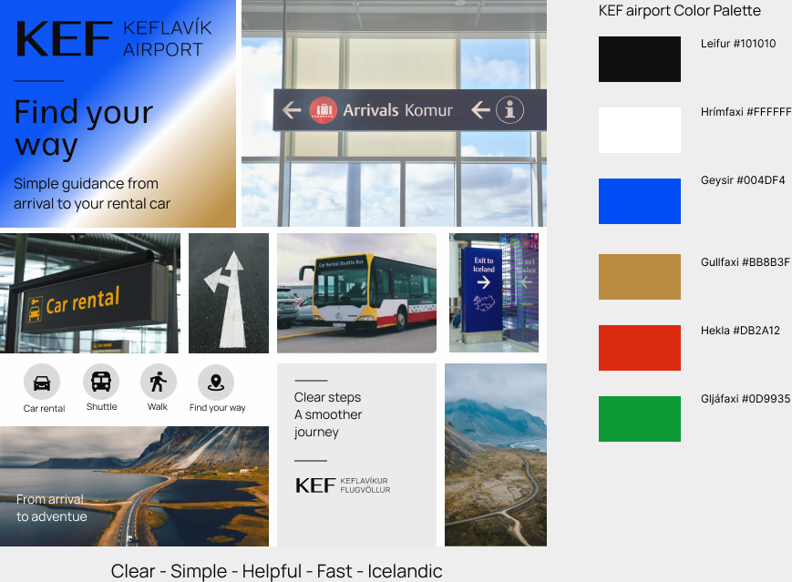

# Sameiginlegt prompt fyrir A og B

Búðu til litla React-vefsíðu, Lestrarhornið, út frá spec.md. Vinna skal eingöngu í úthlutaðri verkefnismöppu (a/ eða b/); sama prompt og sömu gögn gilda fyrir báðar. Ekki breyta prófum, spec.md, sameiginlegum gögnum eða uppsetningu.

Þetta er skólaverkefni um aðgengi. Notaðu íslenskt bókaþema, átta ímyndaðar bækur í shared/books.json og myndir í shared/covers/. Fylgdu litum og letri í shared/style-guide.md. Sá stíll er tímabundinn þar til Module 3 stílleiðarvísir berst. Engar myndir af Module 3 hafa verið afhentar; ekki búa til sönnun fyrir því.

Síðan þarf header með sleppihlekk og nav í þrjá kafla, main, footer, eitt h1 og rétta fyrirsagnaröð. Þrír kaflar:
1. Leit og niðurstöður: reitur merktur "Search", fjöldi niðurstaðna tilkynntur við breytingu, fyrirsögn og mynd fyrir hverja bók, og hnappur með eingöngu tákni, aðgengilegu heiti "Save [bókarheiti]" og sjáanlegri vistunarstöðu.
2. Upplýsingar: hver niðurstaða opnar upplýsingaglugga um bókina. Fókus fer inn, Escape og hnappur merktur "Close" loka, fókus fer aftur á niðurstöðuna.
3. Skráning: "Name", "Email", "Reading format" (select) og samþykkisreitur "I agree to join the reading club". Villutextar birtast við reiti aðeins eftir fyrstu innsendingartilraun. Gild innsending sýnir staðfestingu. Sýniformið sendir eða vistar engar persónuupplýsingar.

Aðalverkefni: leita að Norðurljósum, opna upplýsingar, loka, vista bókina og skrá sig. Síðan á að líta út eins og venjuleg bókaklúbbssíða, ekki námskeið í aðgengi. Ekki bæta við óumbeðnum eiginleikum eða kennsluleiðbeiningum á síðuna.

Byggðu fullbúna útfærslu úr fyrirliggjandi tómu React-inngangsskrá. Prófunarsafnið í tests/ er sameiginlegt og má ekki veikja. Verkefnið keyrir staðbundið; ekki birta það eða breyta Git/GitHub úr þessari byggingarlotu.

## Stílgögn afhent eftir A/B-byggingu

Upprunalegi sameiginlegi byggingarpromptinn hér að ofan er varðveittur. Module 3 var afhent síðar og beitt á loka-B; sjá shared/style-guide.md fyrir frávik og heimildir.

